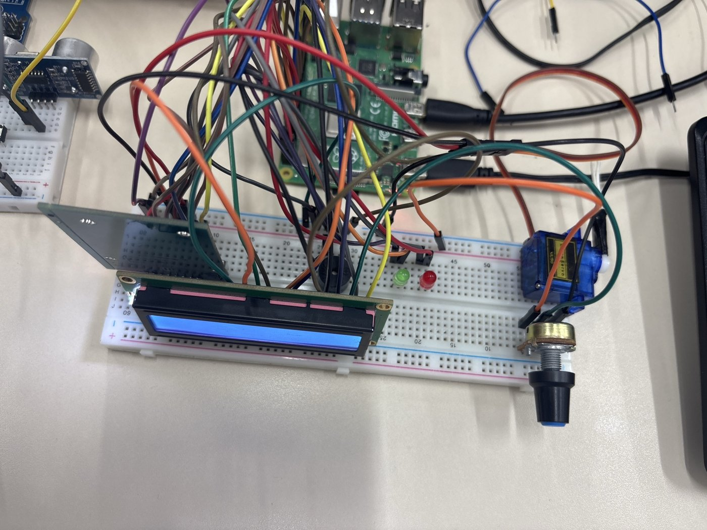

# Sala Segura: controle de acesso com RFID

Projeto final de Hardware Architecture (Atitus, 2026.1). Controle de acesso a uma sala de projeto sob NDA, com Raspberry Pi + RFID na porta, servidor Flask como hub central, painel web para gestão e monitoramento, e análise dos logs em Pandas.

## Integrantes

| Integrante | Responsabilidade | Pasta |
|---|---|---|
| Luiz Eduardo Tremea | Aplicação embarcada (Raspberry, RFID, LCD, cancela, cache offline) | `raspberry/` |
| Bruno Benetti | Servidor Flask, API e painel web | `servidor/` |
| Patrick Marques | Análise de dados (Pandas) e documentação | `analise/`, `docs/` |

## Hardware montado

- Raspberry Pi 4
- Leitor RFID MFRC522
- LED verde e LED vermelho
- Buzzer
- Display LCD 1602A (16x2) ligado em 4 bits, com potenciômetro para o contraste
- Servo SG90 funcionando como cancela



## Como funciona

```
 crachá RFID ──► Raspberry Pi ──HTTP──► Servidor Flask + SQLite ──► Painel web (gestão + monitoramento)
                 LEDs, buzzer,                 ▲                        │
                 LCD, cancela                  │ cache local +          └──► CSV / API ──► Notebook Pandas
                                               │ fila offline
```

1. Ao ligar, a Raspberry baixa o cadastro (`GET /api/sync`) e guarda em `cache_colaboradores.json`.
2. Cada leitura de crachá é validada **localmente** e vira um evento enviado por `POST /api/eventos`.
3. Se o servidor estiver fora, o evento vai para `fila_offline.json` e é reenviado quando a conexão volta (o servidor ignora duplicatas).
4. O painel lê o banco e a página de monitoramento atualiza a cada 3 s por polling em `/api/status`.
5. O notebook lê `/api/eventos.csv` (ou o CSV exportado) e responde as perguntas do enunciado.

### Regras na porta

| Situação | LCD | Atuadores | Evento |
|---|---|---|---|
| Autorizado, 1ª vez no dia | Bem-vindo, {nome} | LED verde, 2 bipes agudos, cancela abre 3 s | `entrada` |
| Autorizado, já entrou hoje | Bem-vindo de volta, {nome} | idem | `entrada` |
| Autorizado, já está dentro | Até logo, {nome} + tempo do dia | idem | `saida` (com duração) |
| Cadastrado sem acesso | Sem acesso ao projeto | LED vermelho, bipe grave | `acesso_negado` |
| Tag desconhecida | ACESSO NEGADO + ID | vermelho piscando + sirene | `invasao` |

Entrada e saída alternam a cada leitura do mesmo crachá. Leituras repetidas em menos de 3 s são ignoradas. Acesso negado e invasão não abrem a cancela.

## Estrutura

```
├── raspberry/      main.py, hardware.py, cliente_api.py, config.py
├── servidor/       app.py, api.py, web.py, db.py, seed.py, templates/, static/
├── analise/        analise_acessos.ipynb, gerar_dados_exemplo.py, dados/acessos.csv
└── docs/           documentacao.pdf, apresentacao.pdf, imagens/
```

## Como rodar

No MVP, o servidor e o leitor rodam na própria Raspberry. Para mover o servidor para outra máquina da rede, basta trocar o `SERVIDOR_URL` em `raspberry/config.py`.

Antes da primeira vez, ative o SPI: `sudo raspi-config` → Interface Options → SPI → Enable.

### 1. Servidor (1º terminal SSH)

```bash
cd servidor
python -m venv env --system-site-packages
source env/bin/activate
pip install -r requirements.txt
python app.py
```

O usuário **admin / admin** é criado automaticamente na primeira execução. O `python seed.py` é opcional: cria colaboradores de exemplo e redefine a senha do admin.

Painel: `http://<ip-da-raspberry>:5000` (descubra o IP com `hostname -I`).

### 2. Leitor RFID (2º terminal SSH)

```bash
cd raspberry
python -m venv env --system-site-packages
source env/bin/activate
pip install -r requirements.txt
python main.py
```

Em `raspberry/config.py`:

```python
SERVIDOR_URL = "http://127.0.0.1:5000"
FECHADURA_TIPO = "servo"
PIR_PINO = None
BOTAO_PINO = None
LDR_PINO = None
```

Sem a placa (ou para testar no PC): `python main.py --simular` e digite o ID da tag + Enter.

### 3. Cadastrar crachás

1. Passe o crachá no leitor. Por ainda não estar cadastrado, ele aparece em **Monitoramento → Tentativas de invasão**.
2. Clique em **Cadastrar** ao lado da tag. O formulário abre com a tag já preenchida.
3. Preencha nome, matrícula e cargo e marque ou desmarque **Possui acesso à sala do projeto**.
4. Salve. Na próxima passada a Raspberry consulta o servidor e já reconhece o crachá.

### 4. Notebook Pandas

```bash
cd analise
pip install -r requirements.txt
jupyter notebook analise_acessos.ipynb
```

Para testar sem crachás reais: `python gerar_dados_exemplo.py http://127.0.0.1:5000 7` gera 7 dias de eventos fictícios.

## Ligações (modo BOARD)

| Componente | Pino físico | GPIO |
|---|---|---|
| RFID SDA / SCK / MOSI / MISO / RST | 24 / 23 / 19 / 21 / 22 | 8 / 11 / 10 / 9 / 25 |
| RFID 3,3 V / GND | 1 / 6 | |
| LED verde / LED vermelho | 11 / 13 | 17 / 27 |
| Buzzer | 12 | 18 |
| GND dos LEDs e do buzzer | 9 | |
| Servo SG90 (sinal) | 15 | 22 |
| LCD RS / E / D4 / D5 / D6 / D7 | 31 / 33 / 35 / 37 / 38 / 40 | 6 / 13 / 19 / 26 / 20 / 21 |
| LCD VDD e BLA / GND, RW e BLK | 5 V (pino 4) / GND (pino 39) | |
| Potenciômetro 10 kΩ | pontas em 5 V e GND, meio no VO do LCD | |

LEDs com resistor de 220 a 330 Ω. O RFID vai no 3,3 V; o LCD e o servo no 5 V. Os pinos D0 a D3 do LCD não são ligados.

## API

| Método | Rota | Uso |
|---|---|---|
| GET | `/api/sync` | cadastro + quem está dentro + quem já entrou hoje |
| POST | `/api/eventos` | um evento ou lista (fila offline) |
| POST | `/api/heartbeat` | estado da Raspberry e da fila pendente |
| GET | `/api/status` | resumo para o monitoramento |
| GET | `/api/eventos` / `/api/eventos.csv` | logs em JSON ou CSV (`?data=AAAA-MM-DD&tipo=`) |

As rotas que a Raspberry usa exigem o cabeçalho `X-Api-Key` (valor em `servidor/config.py` e `raspberry/config.py`).

## Limitações do MVP

- A autenticação do painel é por usuário e senha em sessão; não há perfis nem HTTPS.
- Entrada e saída dependem de o colaborador passar o crachá nas duas direções. Se esquecer na saída, a próxima leitura é tratada como saída.
- Se a Raspberry reiniciar sem rede e sem cache, toda tag é tratada como desconhecida até a primeira sincronização.
- Enquanto o servidor estiver fora, o painel não vê os eventos. Eles chegam juntos na reconexão, com a hora original.
- O servo é alimentado pelo 5 V da Raspberry; numa porta real, a cancela daria lugar a uma fechadura eletromagnética com fonte própria.
